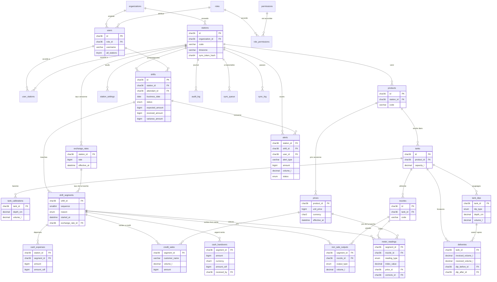

# Petra — schéma de la base de données

Petra — développé par BELEJ-CONSULTING.

Schéma créé par les migrations `database/migrations/0001` à `0016` (MariaDB ≥ 10.11, InnoDB, utf8mb4).
28 tables. Ce document décrit le schéma soumis à validation ; aucun module métier ne l'utilise encore.

## Conventions

| Règle | Mise en œuvre |
| --- | --- |
| Clés primaires UUID | `id CHAR(36) CHARACTER SET ascii COLLATE ascii_bin`, UUID v7 généré en PHP (`Petra\Core\Uuid`), en minuscules. |
| Multi-stations | `station_id` sur toutes les tables métier, toujours en tête d'un index. Sans station : `organizations`, `stations`, `users`, `roles`, `permissions`, `role_permissions`. |
| Traçabilité | `created_at` et `created_by` sur toutes les tables. `created_by` est obligatoire sur les opérations, facultatif sur le référentiel (première ligne, action du système). |
| Ajout seul | Les tables d'opérations, `prices`, `exchange_rates`, `shift_segments` et `audit_log` refusent `UPDATE` et `DELETE` (déclencheurs, migration 0011). |
| Corrections | Nouvelle ligne avec `corrects_id` (ligne corrigée), `correction_reason`, `approved_by`, `approved_at`. La base impose un approbateur, et qu'il soit différent de l'auteur. |
| Montants | `BIGINT` dans la plus petite unité (CDF entier, USD en cents), toujours accompagnés d'une colonne `currency`. |
| Volumes | `DECIMAL(12,2)`, colonnes suffixées `_l` ; index des pistolets `index_value DECIMAL(12,2)`. Hauteurs de jauge `DECIMAL(6,1)` en cm. Aucun `FLOAT`. |
| Versions | `prices` et `exchange_rates` : une ligne par version, datée par `effective_at`. La version en vigueur à l'instant T est la plus récente dont `effective_at` ≤ T. |
| Suppression | Aucune clé étrangère en cascade : rien n'est supprimé, on désactive (`is_active`). |

## Diagramme

Seules les colonnes structurantes sont montrées. Les liens `created_by`, `approved_by` et `corrects_id`
existent sur les tables concernées mais ne sont pas dessinés.

## Tables

### Organisation et droits (0001, 0002, 0010)

| Table | Rôle |
| --- | --- |
| `organizations` | Propriétaire des stations. |
| `stations` | Station-service. `sync_token_hash` : empreinte du jeton de synchronisation, vérifiée par le central. |
| `roles`, `permissions`, `role_permissions` | Droits. Trois rôles fournis : `owner` (25 permissions), `manager` (15), `attendant` (3). Identifiants fixes, identiques partout. |
| `users` | Connexion par `username` (l'e-mail est facultatif). `all_stations = 1` pour le propriétaire. |
| `user_stations` | Stations attribuées à un utilisateur. |

### Installation d'une station (0003, 0004)

| Table | Rôle |
| --- | --- |
| `products` | Produits vendus par la station (Essence, Mazout). Propres à chaque station. |
| `tanks` | Cuve d'un produit, avec sa capacité. |
| `tank_calibrations` | Barème de jaugeage : hauteur en cm → volume en litres. |
| `nozzles` | Pistolet relié à une cuve ; il porte l'index totalisateur. |
| `prices` | Prix du litre par produit, versionné. |
| `exchange_rates` | Taux USD → CDF par station, versionné. `rate` = CDF entiers pour 1 USD. |

### Postes (0005, 0006)

| Table | Rôle |
| --- | --- |
| `shifts` | Poste d'une station, tenu par un pompiste : `open` → `closed` (index clôturés par le pompiste) → `validated` (contre-validation du gérant). Un seul poste ouvert par station. Valeur des ventes figée en CDF à la clôture ; remis et écart viendront avec la remise de caisse. Verrouillé une fois validé. |
| `shift_segments` | Tranche de poste à prix et taux constants. Un changement de prix ou de taux ouvre une nouvelle tranche. |
| `meter_readings` | Relevé d'index d'un pistolet : ouverture et fermeture de chaque tranche, avec le prix en vigueur. `is_rollover` : le compteur est repassé par zéro (`nozzles.rollover_index`). |
| `cash_handovers` | Argent remis. L'USD est converti au taux de la tranche ; `amount_cdf` garde la contre-valeur. |
| `non_sale_outputs` | Volume passé au compteur sans vente : `test`, `calibration`, `internal_use`, `tank_return`. |
| `credit_sales` | Vente à crédit (bon client) : diminue l'argent attendu. |
| `cash_expenses` | Dépense payée par la caisse, rattachée ou non à un poste. |
| `variance_justifications` | Justification d'un écart de caisse par le gérant : nouvelle ligne liée au poste et à son alerte (migration 0013). L'écart constaté n'est jamais modifié. |

Calcul de l'écart d'un poste, en arithmétique entière (`ShiftCalculator` pour les volumes, `CashCalculator` pour la caisse) ; il est figé sur le poste à la contre-validation :

- volume vendu d'une tranche = index de fermeture − index d'ouverture − sorties hors vente (`Petra\Domain\ShiftCalculator`) ;
- CA théorique = Σ (volume vendu × prix de la tranche), converti en CDF au taux de la tranche ;
- caisse attendue = CA théorique − ventes à crédit − dépenses de caisse du poste (`shifts.expected_amount`) ;
- caisse remise = Σ `cash_handovers.amount_cdf`, les dollars étant convertis au taux de leur tranche (`shifts.received_amount`) ;
- écart = caisse remise − caisse attendue (`shifts.variance_amount`), comparé aux seuils de déficit et d'excédent de la station.

### Stock (0007)

| Table | Rôle |
| --- | --- |
| `tank_dips` | Jaugeage : hauteur lue, volume d'après le barème (interpolation linéaire), stock théorique et écart en litres et en CDF, figés à la saisie (migration 0014). Le premier jaugeage d'une cuve fixe son stock initial. |
| `deliveries` | Livraison : quantités commandée (`ordered_volume_l`), annoncée par le bon (`invoiced_volume_l`) et reçue ; jaugeages avant et après ; écarts annoncé / reçu et reçu / variation de cuve figés à la réception ; photo du bon (`photo_path`, sous `storage/uploads/{station_id}/`) (migration 0015). |

Stock d'une cuve (`Petra\Domain\StockCalculator`), depuis son dernier jaugeage :

- stock théorique = stock initial + livraisons − litres vendus − sorties non vendues (+ retours en cuve) ;
- stock physique = volume lu au barème pour la hauteur jaugée ;
- écart = physique − théorique, valorisé au prix en vigueur à l'instant du jaugeage ;
- tolérance = le plus grand entre `stock_tolerance_l` et `stock_tolerance_pct` du volume débité depuis le dernier jaugeage.

Écarts d'une livraison (`Petra\Domain\DeliveryCalculator`), comparés au seuil `delivery_variance_l` :

- écart annoncé / reçu = reçu − annoncé ;
- écart reçu / cuve = (volume jaugé après − volume jaugé avant) − reçu.

### Contrôle et synchronisation (0008, 0009)

| Table | Rôle |
| --- | --- |
| `alerts` | Écart chiffré (montant et/ou volume) rattaché à une station, un poste, un utilisateur. |
| `audit_log` | Journal : qui, quoi, quand, avant / après (JSON). |
| `station_settings` | Réglages par station, sous forme clé / valeur (voir ci-dessous). |
| `sync_queue` | File locale des lignes à transmettre au central, rejouée dans l'ordre de `seq`. Alimentée par les déclencheurs `trg_{table}_sync_{insert,update,delete}` (migration 0016), dans la transaction de l'écriture ; elle ne porte que la table et l'identifiant, l'état de la ligne est lu à l'envoi. Statuts : `pending`, `sent`, `failed`, `conflict`. Rien n'est mis en file sur le central ni pendant une réception (`@petra_sync_apply`). |
| `sync_log` | Journal des passes de synchronisation (envoi, réception), côté station et côté central : statut (`success`, `failed`, `offline`), compteurs dont `items_conflicted`, et `details` (JSON) des lignes rejetées ou en conflit. |

Clés de `station_settings` (`Petra\Domain\StationSettings`) ; une clé absente prend sa valeur par défaut :

| Clé | Contenu | Défaut |
| --- | --- | --- |
| `stock_tolerance_pct` | Tolérance de stock en % (décimal) | `0.50` |
| `stock_tolerance_l` | Tolérance de stock en litres | `50.00` |
| `low_stock_l` | Niveau de stock bas, en litres | `3000.00` |
| `cash_shortage_tolerance_cdf` | Déficit de caisse toléré, en CDF | `5000` |
| `cash_surplus_tolerance_cdf` | Excédent de caisse toléré, en CDF | `5000` |
| `delivery_variance_l` | Écart de livraison toléré, en litres | `100.00` |
| `usd_unallocated_rate` | Tranche dont le taux convertit les dollars remis sans ventilation : `last`, `first`, `lowest`, `highest` | `last` |
| `shift_schedule` | Horaires des postes, en JSON : `[{"label","start","end"}]`, 4 postes au plus | 06:00–12:00, 12:00–18:00 |

Le fuseau de la station est la colonne `stations.timezone`.

## Choix à valider

1. **Un poste ouvert par station, tenu par un pompiste** (migration 0012). `shifts` rattache le poste à un pompiste, ce qui donne l'écart par utilisateur sans table supplémentaire. Plusieurs pompistes en même temps sur une station, chacun sur ses pistolets, demanderaient une table d'affectation.
2. **Une correction est insérée déjà approuvée.** Comme les opérations sont en ajout seul, il n'y a pas de correction « en attente » dans ces tables : l'approbateur (différent de l'auteur) est requis à l'insertion. Un circuit de demande puis d'approbation différée demanderait une table de demandes.
3. **Produits par station.** Demandé tel quel ; la consolidation du propriétaire regroupera par `products.code`.
4. **Prix dans `meter_readings`.** Le prix en vigueur est porté par chaque relevé (`price_id`), le taux par la tranche (`exchange_rate_id`).
5. **Taux entier.** `exchange_rates.rate` est un nombre entier de CDF pour 1 USD. La conversion des cents (`Money::usdCentsToCdf`) arrondit au franc le plus proche, la demi-unité s'éloignant de zéro.
6. **Clients à crédit en texte libre** (`customer_name`) : pas de table clients dans la liste demandée.
7. **Paiements.** `cash_handovers` ne distingue pas espèces et mobile money.

## Données de démonstration

`php bin/seed.php [mot-de-passe]` (base vide uniquement) : une organisation, deux stations
(`LSH-01`, `KZI-01`) ; par station Essence et Mazout, une cuve avec barème et un pistolet par produit,
un gérant et deux pompistes ; un propriétaire. Ajoutés en plus de la demande, pour qu'un poste puisse
être ouvert : un prix par produit, un taux USD/CDF et les seuils par défaut de chaque station.
